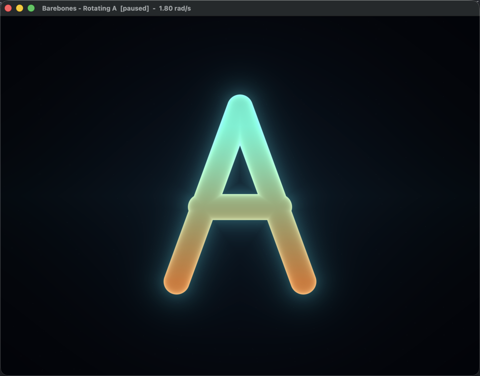

# Barebones

A rotating neon **A**, rendered with SDL, Metal, and a Slang shader on macOS.



## Controls

| Key | Action |
| --- | --- |
| `Space` | Pause / resume |
| `Up` / `W` | Rotate faster |
| `Down` / `S` | Rotate slower |
| `R` | Reset the angle and speed |
| `F` / `F11` | Toggle fullscreen |
| `Esc` / `Q` | Quit |

The window title shows the current speed and whether the game is paused.

## Requirements

- macOS with Metal support (tested on macOS 26.6, Apple Silicon).
- Xcode Command Line Tools: `xcode-select --install` (provides the compiler,
  `clang-format`, and `clangd`).
- CMake 3.25 or newer.
- `curl` and `hdiutil`, both included with macOS.

No Homebrew packages and no full Xcode installation are required. The Metal
compiler that ships with Xcode is not needed: Slang emits Metal Shading
Language at build time, and the app asks Metal to compile that source at
runtime.

## Build and run

From this directory:

```sh
./run.sh
```

The first run downloads pinned versions of SDL3, metal-cpp, and the Slang
compiler into `~/Library/Caches/cpp-games/deps` (roughly 90 MB), builds the app
into a disposable directory under `/tmp`, bundles the shader and SDL3 framework,
and launches the game.

```sh
./run.sh --build-only   # build without launching
./run.sh --clean        # delete /tmp/cpp-games-barebones-build, rebuild, launch
./run.sh --help         # show all options
```

The app bundle is written to:

```text
/tmp/cpp-games-barebones-build/Barebones.app
```

Dependencies are cached, so subsequent builds are quick and offline. Build
outputs deliberately live under `/tmp` and are disposable. The shared caches do
not: macOS's `tmp_cleaner` deletes `/tmp` entries once their access, modification,
and change times are all more than three days old. SDL, Slang, metal-cpp, and
clang-tidy therefore live in `~/Library/Caches/cpp-games`, where they survive
reboots and the system's temporary-directory sweeps.

To force a fresh download, remove the relevant cache:

```sh
rm -rf ~/Library/Caches/cpp-games/deps
rm -rf ~/Library/Caches/cpp-games/tools
```

`run.sh` also copies `compile_commands.json` next to this README so clangd, Zed,
and the VS Code clangd extension resolve every include and compile flag without
editor-specific configuration. Each game keeps its own compile database.

## Local checks and auto-fixes

The project has no CI dependency. `run.sh` installs a tracked Git pre-commit
hook (`.githooks/pre-commit`) automatically, and every commit involving C++,
shader, or build-file changes runs the same checks locally:

1. Build each affected game with `-Werror` enabled.
2. Format changed C++/Objective-C++ files with `clang-format`.
3. Run `clang-tidy`'s `misc-include-cleaner` to remove unused includes and add
   direct includes for symbols that were only available transitively.
4. Rebuild, then verify formatting and include hygiene before the commit lands.

Fixes are re-staged automatically. The first commit that needs them downloads a
pinned `clang-tidy` binary (about 31 MB) into
`~/Library/Caches/cpp-games/tools`; the macOS Command Line Tools already
provide `clang-format`, so no Homebrew install is needed. If a staged source file also has unstaged edits, the hook stops rather
than mixing your fixes with unrelated work. Stage or stash those edits and
commit again.

You can run the checks manually:

```sh
Tools/check.sh --all            # check every game source, no modifications
Tools/check.sh --all --fix      # format and clean includes across all games
Tools/check.sh --staged         # check exactly what is staged, no modifications
```

The shared rules live at the repository root:

- [`.clang-format`](../../.clang-format) — formatting style.
- [`.clang-tidy`](../../.clang-tidy) — include-cleaner configuration; third-party
  and SDK headers are deliberately excluded from automatic rewriting.
- [`Tools/check.sh`](../../Tools/check.sh) — format, include, and build checks.
- [`Tools/fetch-clang-tidy.sh`](../../Tools/fetch-clang-tidy.sh) — pinned local
  clang-tidy download.

To disable the hook, run `git config --local core.hooksPath /dev/null`. To bypass
it once, use `git commit --no-verify`.

## Dependency setup

The exact versions and SHA-256 checksums live in
[`ThirdParty/fetch-dependencies.sh`](ThirdParty/fetch-dependencies.sh).

| Dependency | Pin | Role |
| --- | --- | --- |
| [SDL3](https://www.libsdl.org) | 3.4.18 | Window, input, and the `CAMetalLayer` host view |
| [metal-cpp](https://developer.apple.com/metal/cpp/) | `metal-cpp_macOS26.4_iOS26.4` | Header-only C++ bindings for Metal |
| [Slang](https://shader-slang.org) | 2026.20 | Master shader language; compiles to Metal Shading Language |

The SDL `.dmg` is mounted read-only and only `SDL3.framework` is copied into the
cache. Nothing is installed system-wide. The framework is copied into
`Barebones.app/Contents/Frameworks` at build time and located through an
`@executable_path` rpath, so the bundle is self-contained.

### How the build is wired

[`CMakeLists.txt`](CMakeLists.txt) performs four jobs:

1. Exposes the cached SDL3 framework and metal-cpp headers to the target.
2. Runs `slangc` on [`Shaders/sprite.slang`](Shaders/sprite.slang) to produce
   `<build>/generated/sprite.metal`.
3. Links the executable as a macOS app bundle and copies the generated shader
   into `Contents/Resources/shaders`.
4. Copies `SDL3.framework` into `Contents/Frameworks` and sets the rpath.

This subset of the [V0 architecture](../../Docs/Architecture/V0.md) keeps
platform code out of the gameplay layer:

```text
01-Barebones/
├── CMakeLists.txt
├── README.md
├── run.sh
├── ThirdParty/
│   └── fetch-dependencies.sh
├── Shaders/
│   ├── common.slang            # uniforms, SDF math, background helpers
│   └── sprite.slang            # fullscreen vertex + letter fragment shader
├── Docs/
│   └── screenshot.png
└── Sources/
    ├── App/
    │   └── Main.cpp            # SDL bootstrap, events, frame pacing
    ├── Core/                   # platform-agnostic gameplay
    │   ├── Game.hpp/.cpp
    │   ├── GameLoop.hpp/.cpp
    │   └── GameTypes.hpp
    ├── Render/                 # engine seam
    │   ├── IRenderer.hpp
    │   └── PipelineState.hpp
    └── Platform/macOS/
        ├── MetalImpl.mm        # metal-cpp private implementation
        ├── MetalRenderer.hpp
        └── MetalRenderer.cpp   # Metal device, pipeline, draw
```

## Code walkthrough

The frame flows from top-left to bottom-right through the tree above:

**1. `App/Main.cpp` starts the platform.**

It initializes SDL, creates a 960×720 resizable window with
`SDL_WINDOW_METAL | SDL_WINDOW_HIGH_PIXEL_DENSITY`, creates the Metal host view
with `SDL_Metal_CreateView`, and extracts its `CAMetalLayer` via
`SDL_Metal_GetLayer`. It then asks the macOS factory for an `IRenderer`, passes
the layer through the renderer-neutral `NativeSurface` struct, and enters the
loop.

Each iteration drains SDL events, converts keyboard input into `Game` commands,
measures elapsed time with `SDL_GetPerformanceCounter`, and advances the fixed
timestep loop. It queries the drawable size in pixels each frame, so dragging
between Retina and non-Retina displays works without extra resize plumbing.
Finally it builds a `RenderFrame` and calls `renderer->draw`.

A small interpolation detail keeps motion smooth: after the fixed updates,
`GameLoop::remainderSeconds()` still contains a fraction of a step. `Main`
rotates the rendered angle by `rotationSpeed * remainder`, while simulation
itself remains on the fixed 120 Hz grid.

**2. `Core/GameLoop.cpp` owns time.**

The accumulator adds the real frame time (clamped to 250 ms to survive a
suspended process) and runs zero or more 1/120 s updates. At most eight updates
are allowed per display frame; if the machine falls further behind, excess
accumulated time is dropped rather than causing a spiral of death. Simulation
state therefore never depends on the render frame rate.

**3. `Core/Game.cpp` owns the game.**

`Game` contains only `GameState`: angle, elapsed simulated time, rotation speed,
and a pause flag. `update` advances the angle modulo 2π; the input methods clamp
speed and toggle pause. There are no SDL, Metal, or shader types in `Core/`.
`reset` deliberately preserves the paused state while restoring angle, time,
and the default speed.

**4. `Render/` defines the seam.**

`IRenderer` is the platform boundary. `RenderFrame` carries only plain values:
the angle, simulated time, and pixel dimensions. `NativeSurface` is the one
place a native handle crosses the boundary, and it does so as an opaque
`void*`. A different backend (Vulkan, D3D12, or a software renderer) can
implement `IRenderer` without touching `Core/` or `App/`.

**5. `Platform/macOS/` implements Metal.**

`MetalImpl.mm` is the single translation unit that expands metal-cpp's private
implementation macros. `MetalRenderer.cpp` creates the system Metal device,
command queue, and render pipeline. On first initialization it reads the
Slang-generated `.metal` text from the app bundle and compiles it with
`newLibraryWithSource`; the resulting vertex and fragment functions are wired
into a `MTLRenderPipelineState` targeting `BGRA8Unorm`.

For every frame it acquires the next drawable, clears it, uploads a 16-byte
uniform block with `setVertexBytes` / `setFragmentBytes` at buffer index 0, and
draws a single triangle covering the screen. Because the letter is evaluated in
the fragment shader, no vertex or index buffers are needed.

**6. `Shaders/` draws the letter.**

The vertex shader emits a fullscreen triangle from only `SV_VertexID`. The
fragment shader:

- Converts the fragment UV into aspect-corrected centered coordinates.
- Rotates those coordinates by the current angle.
- Computes the signed distance to the union of three rounded capsules (the two
  legs and the crossbar of an **A**).
- Uses `fwidth` of the distance for resolution-independent antialiasing, plus
  exponential falloff for the neon halo.
- Blends a teal-to-amber gradient, adds a subtle inner rim, a fixed star field,
  and a vignette.

`common.slang` owns the `Uniforms` struct, so the shader and the C++ renderer
share one explicit 16-byte layout. The `static_assert`s in `MetalRenderer.cpp`
guard that contract.

**7. `ThirdParty/fetch-dependencies.sh` makes the build reproducible.**

It downloads each archive once, verifies its SHA-256 before use, and extracts
only the needed framework/headers/compiler into the cache. CMake fails with a
clear instruction if the cache is missing, which is why `run.sh` always calls
the fetch script before configuring.

## Troubleshooting

- **`ld: framework 'SDL3' not found`** — run through `./run.sh`; a raw `cmake`
  invocation must also pass
  `-DCPP_GAMES_DEPS_DIR=~/Library/Caches/cpp-games/deps`.
- **A shader compile error appears at startup** — the generated source is at
  `<build>/generated/sprite.metal`. The error text from Metal includes the line
  number in that file.
- **Window is hidden behind the terminal** — the app activates itself on launch;
  click the window if macOS keeps the terminal in front.
- **Old dependency version after editing pins** — delete
  `~/Library/Caches/cpp-games/deps/downloads` and rerun.

## Next steps

The game is intentionally small. Natural extensions are moving the letter with
the arrow keys (adding velocity and collision to `GameState`), drawing several
characters from a shared SDF atlas, or adding a second `IRenderer`
implementation to exercise the platform seam.
