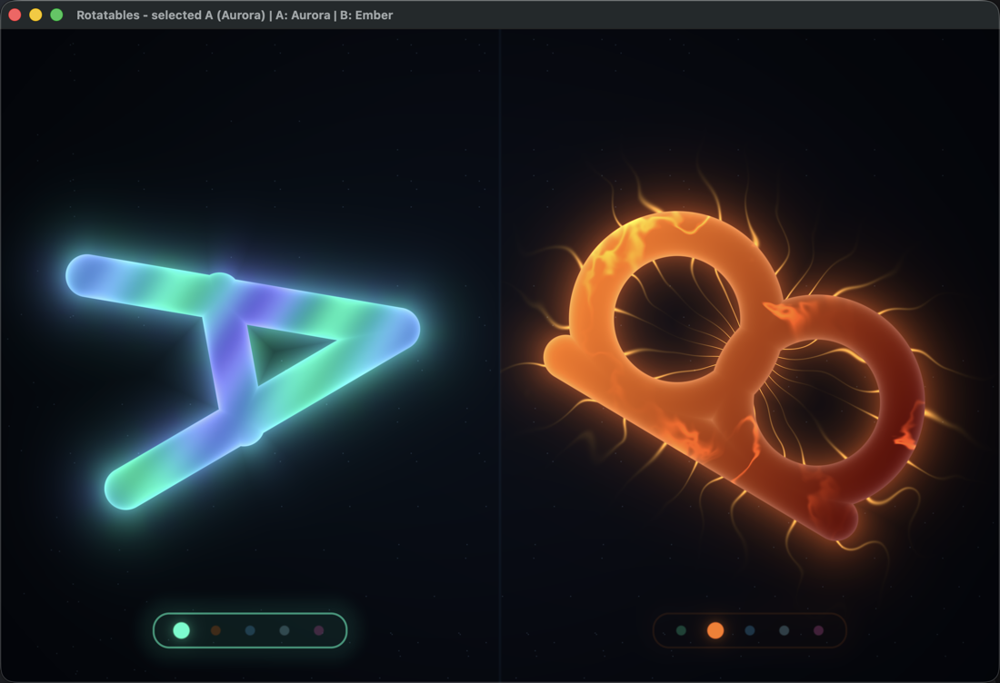

# Rotatables

Rotating **A** and rotating **B** are neighbors. Each has its own rotation and
skin; the selected neighbor's skin selector is framed in its accent color.



## Controls

| Key | Action |
| --- | --- |
| `Left` | Select A |
| `Right` | Select B |
| `Space` | Cycle the selected neighbor's skin |
| `R` | Reset both angles, skins, and selection |
| `F` / `F11` | Toggle fullscreen |
| `Esc` / `Q` | Quit |

The window title always shows the selected neighbor and both current skins.

## Skins

| Skin | Surface effect | Edge effect |
| --- | --- | --- |
| Aurora | Slow color ribbons flowing through the glyph | Colored mist |
| Ember | Molten cracks opening and healing | Sparking embers |
| Arc | Two sweeping spotlights and scanlines | Small lightning streaks |
| Frost | Crystalline facets and glints | Drifting vapor |
| Prism | Iridescent interference bands | Rainbow shimmer and sparkles |

A starts on Aurora and B starts on Ember, so the two independent skins are
visible immediately.

## Build and run

Same prerequisites as [Barebones](../01-Barebones/README.md): macOS, Xcode
Command Line Tools, and CMake 3.25+. No Homebrew packages or full Xcode install
is needed.

```sh
./run.sh
```

The first run downloads the pinned SDL3, metal-cpp, and Slang versions into
`~/Library/Caches/cpp-games/deps` and builds into a disposable directory under
`/tmp`. Subsequent builds are incremental.

```sh
./run.sh --build-only   # build without launching
./run.sh --clean        # rebuild from scratch
./run.sh --stats        # launch and print CPU + RSS every second
./run.sh --help
```

The app bundle is written to
`/tmp/cpp-games-rotatables-build/Rotatables.app`.

The `--stats` switch runs the game through
[`Tools/run-with-stats.sh`](../../Tools/run-with-stats.sh), which samples the
game process once per second and prints its CPU percentage and resident set
size in MB:

```text
[stats] 22:21:38  CPU   6.6%  RSS   84.8 MB
```

Ctrl-C stops both the sampler and the game.

`run.sh` also installs the repository pre-commit hook and writes
`compile_commands.json` next to this README for clangd.

## Main software engineering points

### A deliberate copy, then a refactor

Rotatables began as a copy of Barebones' proven SDL/Metal/Slang bootstrap, but
the single-purpose files were split further:

- `GameState.hpp` describes only data.
- `Game.cpp` owns transitions and rotation integration.
- `Skins.hpp` owns the skin enum and cycling.
- `RenderFrame.hpp` is the renderer-neutral frame contract.
- `ShaderPipeline` owns MSL compilation and pipeline creation.
- `MetalRenderer` owns the device, drawable, pass, and frame submission.
- `MetalImpl.mm` is still the only file that expands metal-cpp's private
  implementation macros.

Each file now has one reason to change. `Main.cpp` translates input and data; it
contains no simulation rules or Metal calls.

### Per-character state instead of global modes

Selection and skin are not special game modes. Each neighbor is a
`CharacterState`:

```text
angleRadians + rotationSpeed + skin
```

The game state adds `selectedIndex` and elapsed time. This makes selection a
single index change, lets the two characters rotate in opposite directions, and
keeps future features (speed changes, more glyphs, individual effects) local to
the character that owns them.

`Game::update` advances both rotations and wraps angles into `[0, 2π)`.
`Main` adds the fixed-step remainder to the rendered angle, so motion stays
smooth without moving simulation off its deterministic 120 Hz grid. The
renderer receives only plain `RenderFrame` data.

### The render seam stays intact

`IRenderer` accepts a `NativeSurface` containing an opaque Metal layer pointer.
Core has no SDL or Metal headers. App knows SDL; Platform knows Metal. A second
backend can implement the same interface without touching gameplay code.

### Five skins as shader programs, not assets

There are no textures or sprite sheets. One fullscreen triangle covers the
window, and the fragment shader evaluates:

- two signed distance fields for the A and B strokes,
- the selected/unselected scale and accent,
- a per-skin fill function,
- a per-skin edge function,
- antialiasing from `fwidth`, and
- a compact selector around each row of skin pips.

`skinFill` and `skinEdge` are separate functions selected by an integer uniform.
Adding a skin means extending the enum, appending its functions, and adding its
pip color; the renderer and game state need no changes beyond that.

The two panels are laid out from the current aspect ratio each frame. Glyphs
rotate around their own centers while the selectors and pips stay upright,
which keeps the interface readable at every rotation angle.

### Include/format/build checks are local

The repository pre-commit hook now discovers every game under `Games/`,
builds each affected game with `-Werror`, formats changed C++/Objective-C++
files, and runs `misc-include-cleaner`. Fixes are re-staged automatically. The
same commands are available manually:

```sh
Tools/check.sh --all
Tools/check.sh --all --fix
Tools/check.sh --staged
```

See the [Barebones README](../01-Barebones/README.md#local-checks-and-auto-fixes)
for the full tooling setup.

## Source layout

```text
02-Rotatables/
├── CMakeLists.txt
├── README.md
├── run.sh
├── Docs/
│   └── screenshot-compact-selectors.png
├── Shaders/
│   ├── common.slang        # uniforms, noise, glyph SDFs, palette
│   ├── skins.slang         # five fill effects + five edge effects
│   └── scene.slang         # fullscreen vertex, layout, HUD, composition
├── ThirdParty/
│   └── fetch-dependencies.sh
└── Sources/
    ├── App/
    │   └── Main.cpp        # SDL bootstrap, input, frame assembly
    ├── Core/
    │   ├── Game.cpp/.hpp
    │   ├── GameLoop.cpp/.hpp
    │   ├── GameState.hpp
    │   └── Skins.hpp
    ├── Render/
    │   ├── IRenderer.hpp
    │   └── RenderFrame.hpp
    └── Platform/macOS/
        ├── MetalImpl.mm
        ├── MetalRenderer.cpp/.hpp
        ├── SceneUniforms.hpp
        └── ShaderPipeline.cpp/.hpp
```

## Frame walkthrough

1. `Main` creates the SDL window and Metal layer, then hands the layer to the
   renderer through `NativeSurface`.
2. SDL events map to `Game::select`, `Game::cycleSelectedSkin`, and
   `Game::reset`. Simulation runs in fixed 1/120 s steps through `GameLoop`.
3. `Main` copies the selected index, both angles, and both skin IDs into a
   `RenderFrame`. The leftover accumulator fraction is applied only to the
   rendered angles.
4. `MetalRenderer` fills a 32-byte `SceneUniforms` block that matches the Slang
   struct. `ShaderPipeline` has already compiled `scene.metal`, which Slang
   generated during the build.
5. The fragment shader chooses the left or right panel, rotates that glyph's
   coordinates, evaluates the stroke SDF and the active skin, then adds the
   compact skin selector and five pips.

## Extending the game

- Add a skin by extending `Skin`, `kSkinNames`, `skinFill`, `skinEdge`, and
  `accentColor`.
- Add a glyph by extending the shader's distance field and the two-character
  render layout. `RenderFrame` already uses an array, but the current uniform
  layout has one angle/skin slot per character.
- Add movement by giving `CharacterState` a position and feeding it through
  `RenderFrame`; the Metal seam does not need to change.
