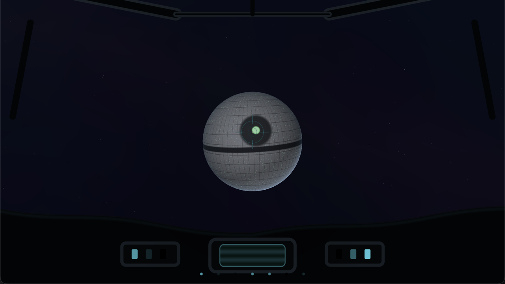

# Death Star Approach Lab

A standalone camera lab for the SpaceBattle opening:

1. **Approach** — the camera starts far out and accelerates toward the Death
   Star, dropping in altitude and banking slightly.
2. **Swoop** — the last approach second dives at the surface; a short blackout
   covers the hand-off.
3. **Trench run** — the camera settles into the equatorial trench and runs
   forward over the panel floor and ribs.

The loop lasts thirteen seconds: four seconds of approach, then nine seconds of
trench run.



## Controls

| Input | Action |
| --- | --- |
| `Space` | Restart at the approach |
| `P` | Pause / resume |
| `C` | Toggle the cockpit overlay |
| `F` / `F11` | Toggle fullscreen |
| `Q` / `Esc` | Quit |

## Build

```sh
./run.sh
./run.sh --build-only
./run.sh --stats
```

Dependencies are shared with the other projects in
`~/Library/Caches/cpp-games/deps`. The default build directory is
`/tmp/cpp-games-labs-death-star-build`.

## Architecture

This lab deliberately reuses the game's rendering data instead of copying it:

- `../../Shaders/scene.slang` supplies the Death Star, trench, panel, and sky
  materials.
- `../../Sources/Platform/macOS/MeshLibrary.cpp` supplies the sphere and trench
  geometry.
- `../../Sources/Platform/macOS/Pipelines.cpp` supplies the scene pipeline.
- [`Engine/Cockpit`](../../../../Engine/Cockpit/README.md) supplies the cockpit
  overlay.

The lab itself owns only the camera choreography, phase timing, render target,
and draw list. That makes it a faithful testbed for the game's approach and
trench cameras without maintaining a second Death Star shader.
