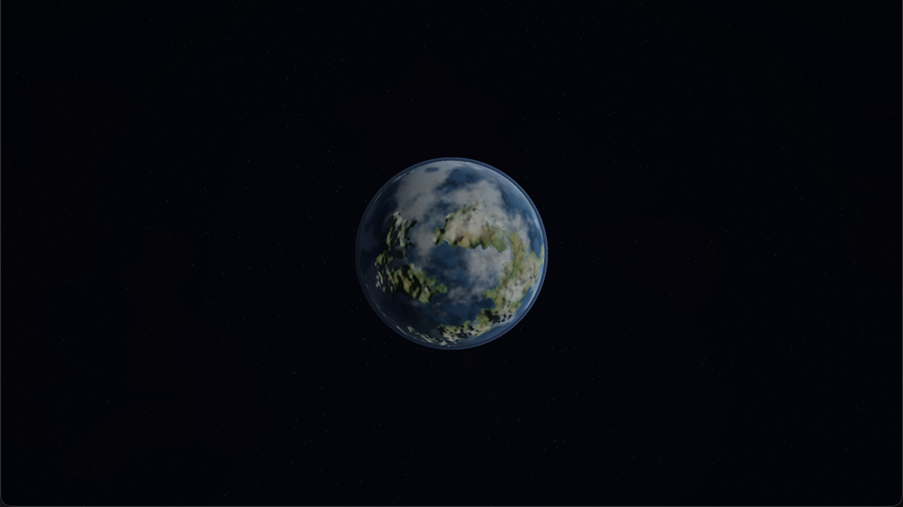

# Planet Lab

A standalone procedural planet generator. It opens on the same curated planet
seed as SpaceBattle. Every press of `Space` creates a new world: different
surface archetype, colours, clouds, ice, craters, lava, atmosphere, axial tilt,
rotation, and optional rings.



## Run it

```sh
./run.sh
./run.sh --build-only
./run.sh --stats
```

The app is written to `/tmp/cpp-games-labs-planet-build/PlanetLab.app`.

## Controls

| Input | Action |
| --- | --- |
| `Space` | Generate a completely new planet |
| `P` | Pause/resume the planet's rotation |
| `F` / `F11` | Fullscreen |
| `Esc` / `Q` | Quit |

The window title shows the current seed, archetype, and whether the planet has
rings.

## What varies

The CPU seed drives a `PlanetSpec`; the shader turns that into a world.

- **Archetypes**: Terran, Desert, Arctic, Volcanic, Gas giant, Pockmarked moon,
  Toxic.
- **Surface**: layered 3D FBM, domain warping, ridged noise, cellular craters,
  ocean/land masks, ice caps, maria, lava fissures, gas bands and storm ovals.
- **Relief**: procedural height gradients perturb the surface normal, so
  mountains, crater rims, and lava channels catch the light.
- **Clouds**: animated FBM cloud layers with coverage and speed per planet.
- **Lighting**: day/night terminator, ocean/ice specular highlights, night-side
  city lights, atmospheric rim, and a random key-light direction.
- **Rings**: optional, with inner/outer radius, opacity, colour, axial tilt,
  planet shadow on the rings, and ring shadow on the planet.
- **Atmosphere**: tinted additive shell whose density and colour vary per world.
- **Camera/framing**: axial tilt changes how the rings and poles are presented.

All surface values are continuous random floats, so the seed space is
effectively infinite; the seven archetypes are just the starting vocabulary.

## Architecture

```text
Planet Lab/
├── Shaders/starfield.slang  # distant stars
├── Sources/
│   ├── App/Main.cpp          # SDL, seed cycling, title
│   └── Platform/macOS/
│       ├── PlanetLabRenderer.cpp
│       └── Math.hpp
└── run.sh

Engine/Planets/
├── Shaders/planet.slang      # surface, atmosphere, relief
├── Shaders/rings.slang       # ring bands and shadowing
├── Include/Planets/          # PlanetSpec and PlanetRenderer
└── Sources/                  # shared generator and renderer
```

The planet is a 128×64 sphere mesh. The shared fragment shader is the main
generator; the CPU only chooses the seed, archetype, palette, and continuous
parameters. There are no imported textures or models.

## Scope

This lab intentionally renders only the planet, rings, atmosphere, and
starfield. It shares [`PlanetSpec`](../../../../Engine/Planets/Include/Planets/PlanetSpec.hpp)
and [`PlanetRenderer`](../../../../Engine/Planets/Include/Planets/PlanetRenderer.hpp)
with SpaceBattle; the game draws a curated planet with the same module.
