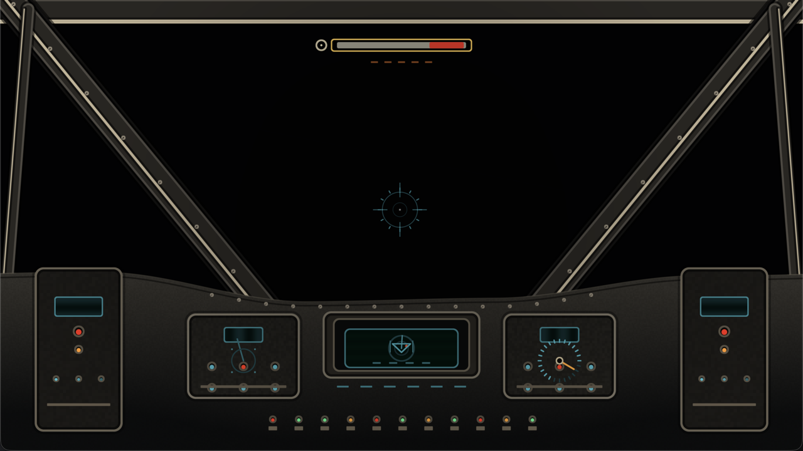

# X-Wing Cockpit Lab

A focused, standalone demo for evaluating the X-Wing cockpit overlay before it
is used in [Space Battle](../../README.md).



The same shared [Engine/Cockpit](../../../../Engine/Cockpit/README.md) module is used
by both the lab and the game. There is no copied cockpit shader or duplicated
pipeline setup.

## Run it

Same prerequisites as the games: macOS, Xcode Command Line Tools, CMake 3.25+.

```sh
./run.sh
./run.sh --build-only
./run.sh --stats       # CPU + RSS every second
```

The app bundle is written to
`/tmp/cpp-games-labs-cockpit-build/XWingCockpitLab.app`.

## Controls

| Input | Action |
| --- | --- |
| `Left` / `A`, `Right` / `D` | Steer; the reticle shifts with the cockpit |
| `Space` | Fire; brightens the reticle |
| `J` | Trigger hyperspace |
| `X` | Trigger explosion flash |
| `P` | Pause auto-demo and freeze a frame |
| `T` | Toggle auto-demo |
| `H` | Toggle HUD |
| `C` | Toggle canopy frame |
| `V` | Toggle dashboard/instrument panels |
| `[` / `]` | Decrease/increase glass tint |
| `-` / `=` | Decrease/increase HUD scale |
| `1`–`4` | Presets: Classic, HUD Focus, Heavy Glass, Minimal |
| `R` | Reset |
| `F` / `F11` | Fullscreen |
| `Esc` / `Q` | Quit |

The window title reports the current preset, visibility flags, tint, HUD scale,
and whether the auto-demo is running.

## What the lab renders

- **Only the cockpit.** The clear is a neutral dark field; there is no star
  field, planet, Death Star, or 3D scene behind the overlay.
- A wraparound metal dash with rising side consoles, a central targeting
  display, radar, speed gauge, switch banks, canopy frame, and HUD.
- `Engine/Cockpit`: the real, shared cockpit overlay, compiled from the same
  shader that SpaceBattle uses.
- [`Sources/Platform/macOS/CockpitLabRenderer.cpp`](Sources/Platform/macOS/CockpitLabRenderer.cpp):
  owns the SDL Metal layer and encodes the cockpit overlay directly. It has no
  backdrop pipeline, game scene, depth buffer, or 3D renderer.
- [`Sources/Demo/CockpitDemo.cpp`](Sources/Demo/CockpitDemo.cpp): presentation
  state only. Auto-demo, presets, toggles, tint/scale adjustments, and transitions
  are separate from rendering.

## Shared state

The contract is [`CockpitState`](../../../../Engine/Cockpit/Include/Cockpit/CockpitState.hpp):

```text
time, phase, phaseTime, flash, jump, steer, firing,
showCanopy, showDashboard, showHud, glassTint, hudScale
```

SpaceBattle passes the phase and gameplay values and leaves the visual toggles at
their defaults. The lab exposes those toggles as controls and presets.

## Iteration workflow

1. Run `./run.sh`.
2. Use presets and toggles to find the version worth keeping.
3. Edit `Engine/Cockpit/Shaders/cockpit.slang` (or the C++ overlay if the API
   changes).
4. Re-run the lab to compare.
5. The game already consumes the same module; run `Games/03-SpaceBattle/run.sh`
   to validate the integration in context.

Because the shader is copied into the bundle on every build, a shader-only edit
does not require relinking either app.

## Verification

`Tools/check.sh` discovers CMake projects under `Games/`, including this nested
lab. The pre-commit hook builds the lab and every game with `-Werror`,
formats changed sources, and cleans includes. The shared engine sources are
checked against the SpaceBattle compile database.
