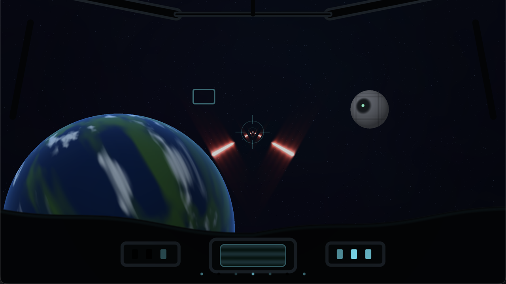

# X-Wing Laser Lab

A focused demo for the shared X-Wing laser renderer, with the same cockpit
overlay used by SpaceBattle. It fires one bolt type modeled on the X-Wing's
red-orange cannon lasers.



## Run it

Same prerequisites as the games: macOS, Xcode Command Line Tools, CMake 3.25+.

```sh
./run.sh
./run.sh --build-only
./run.sh --stats
```

The app bundle is written to
`/tmp/cpp-games-labs-laser-build/XWingLaserLab.app`.

## Controls

| Input | Action |
| --- | --- |
| `Space` | Fire a dual volley |
| `T` | Toggle auto-fire |
| `P` | Pause |
| `C` | Toggle the cockpit overlay |
| `R` | Reset |
| `F` / `F11` | Fullscreen |
| `Esc` / `Q` | Quit |

The window title reports whether auto-fire is active and whether the cockpit
overlay is visible.

## Architecture

- [`Engine/Lasers`](../../../../Engine/Lasers/README.md) — shared `LaserBeam`
  data, `XWingCannon` volley builder, `LaserRenderer`, and `laser.slang`.
- [`Sources/Demo/LaserDemo.cpp`](Sources/Demo/LaserDemo.cpp) — demo timing,
  auto/manual control, and cockpit state. No Metal.
- [`Sources/Platform/macOS/LaserLabRenderer.cpp`](Sources/Platform/macOS/LaserLabRenderer.cpp)
  — owns the SDL Metal layer, the procedural backdrop, the shared laser pass,
  and the shared cockpit overlay.
- [`Shaders/backdrop.slang`](Shaders/backdrop.slang) — stars, planet, and target
  for context.

`LaserDemo::beams()` asks the shared `XWingCannon` builder for the volley
stream. The lab and SpaceBattle use the same muzzle offsets, bolt speed/length,
0.62 s fire period, and `kXWingLaserVisual` preset, so the starting point and
cadence match. The bolts converge on and disappear into the shared HUD reticle.
The renderer then projects the beams to screen space and draws additive glowing
segments.

## Pluggable into SpaceBattle

SpaceBattle links the same module and compiles the same shader. Its renderer
builds a `LaserFrame` from the active camera and calls `LaserRenderer::encode`
after the scene and before the cockpit. SceneBuilder only produces world-space
beam data, so changing the laser look does not touch game logic.

Because the effect is screen-space, beams are not depth-occluded by asteroids or
the Star Destroyer. That trade keeps the shader cheap and the core perfectly
centered; it is the current lab behavior.

## Verification

`Tools/check.sh` discovers nested labs under `Games/`, builds this lab and
every game with `-Werror`, formats changed sources, and cleans includes. The
shared laser source is checked against the SpaceBattle compile database.
