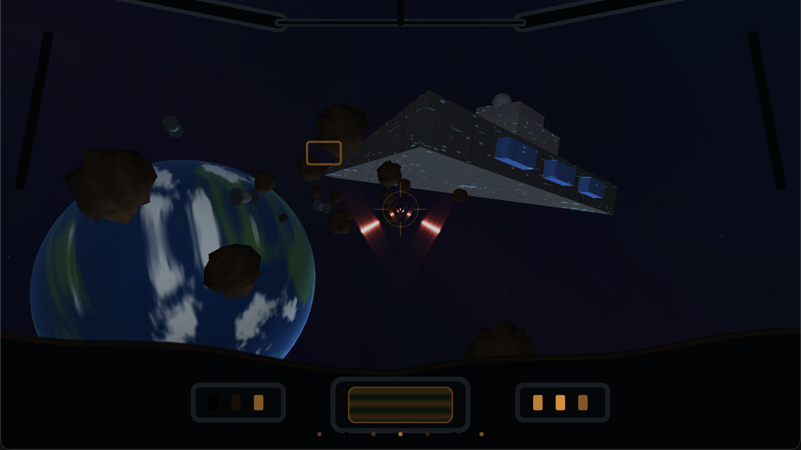

# Space Battle

A demo-mode X-Wing attack loop: approach an orbiting Death Star, dive into the
trench, destroy it, jump to hyperspace, survive an asteroid/Star Destroyer
gauntlet, and arrive at the next objective.



Everything is procedural. There are no imported models, textures, audio
files, or image assets; the meshes and surface detail are generated in code.

## Demo loop

| Phase | Length | What happens |
| --- | --- | --- |
| Death Star approach | 7 s | Planet and orbiting battle station fill the canopy; TIEs and laser fire cross the view. |
| Trench run | 11 s | The camera threads a procedural trench toward the exhaust port. |
| Death Star destroyed | 4.5 s | An external cut shows the station erupt; debris and a flash sell the hit. |
| Hyperspace jump | 2.8 s | Star streaks and cockpit lighting transition to the next objective. |
| Asteroid gauntlet | 11 s | A Star Destroyer, asteroids, TIEs, and turbolaser fire make up the escape corridor. |

The loop then returns to the approach phase with the Death Stars Destroyed
counter incremented.

## Controls

| Input | Action |
| --- | --- |
| `Left` / `A`, `Right` / `D` | Steer the cockpit laterally |
| `Space` | Fire the cannons |
| `P` | Pause / resume |
| `1`–`5` | Preview approach, trench, explosion, jump, or gauntlet |
| `F` / `F11` | Toggle fullscreen |
| `Esc` / `Q` | Quit |

The window title shows the current phase, paused state, and number of Death
Stars destroyed.

## Build and run

Same prerequisites as the other games: macOS, Xcode Command Line Tools, and
CMake 3.25+. No Homebrew packages or full Xcode install are required.

```sh
./run.sh
./run.sh --build-only
./run.sh --stats        # print CPU + RSS every second through Tools/run-with-stats.sh
```

The app bundle is written to
`/tmp/cpp-games-spacebattle-build/SpaceBattle.app`. Pinned SDL3, metal-cpp, and
Slang dependencies are shared with the other games in
`~/Library/Caches/cpp-games/deps`.

## How a frame is built

### CPU: simulation, camera, scene graph, and transforms

1. [`BattleGame.cpp`](Sources/Core/BattleGame.cpp) owns the demo timeline,
   phase transitions, steering, pause, and preview shortcuts. It has no SDL or
   Metal dependency.
2. [`SceneBuilder.cpp`](Sources/Render/SceneBuilder.cpp) turns the current
   phase into a `RenderFrame`: camera position/orientation, object transforms,
   lasers, explosion timing, and the additive draw list.
3. [`MeshLibrary.cpp`](Sources/Platform/macOS/MeshLibrary.cpp) generates all
   static geometry once at startup. The renderer uploads one vertex buffer and
   one index buffer, with a `MeshRange` for each model.
4. [`MetalRenderer.cpp`](Sources/Platform/macOS/MetalRenderer.cpp) builds the
   view/projection matrices, uploads per-frame and per-object uniforms, and
   encodes the draw calls.

This is the CPU's main job: decide what exists, where it is, how the camera
moves, and which draw ranges/uniform values represent the frame. The CPU also
handles SDL input, the fixed 120 Hz simulation loop, and the demo's scripted
transitions.

### GPU: one pass, three pipelines

The frame uses a single render pass with a color target and a depth texture:

1. **Opaque scene** — every mesh is transformed by the vertex shader, lit in
   the fragment shader, and depth-tested. The sky is a large procedural sphere
   drawn first.
2. **Additive effects** — laser bolts and explosion shells are drawn with
   depth testing but no depth writes and additive blending.
3. **Cockpit overlay** — the shared `Engine/Cockpit` module draws the canopy,
   HUD, hyperspace streaks, and flash with normal alpha blending.

There are no offscreen render targets or post-processing passes. This keeps
the workload TBDR-friendly on Apple GPUs: geometry is submitted once, opaque
work resolves into tile memory, and only the final composition reaches memory.
See the [TBDR notes](https://github.com/dlcmh/filed-away/tree/main/notes/hardware/tbdr-gpu-architecture-google-ai-mode)
linked in the original brief.

## 3D meshes and models

All models live in one static `MeshBatch` and are drawn with the same pipeline.

| Mesh | Used for | Notes |
| --- | --- | --- |
| Sphere | Death Star, sky dome, explosion shells | High-tessellation UV sphere; material shader supplies the surface. |
| Asteroid | Gauntlet obstacles | Low-poly sphere with deterministic radial noise and flat-shaded-looking rock color. |
| TIE fighter | Enemy fighters | Sphere cockpit, hex wings, and twin struts generated from primitives. |
| Star Destroyer | Gauntlet backdrop | Triangular wedge hull plus bridge tower, shield domes, and engine banks. |
| Trench | Trench run | Long floor/walls made from box sections, ribs, and edge towers. |
| Box | Exhaust port, towers, debris | Unit cube transformed per draw. |

The X-Wing itself is not a mesh: the cockpit is a screen-space shader overlay.
That is a deliberate tradeoff: it gives a convincing first-person frame and HUD
without a cockpit model, while the expensive 3D work stays in the world behind
the glass.

The Death Star and sky reuse the sphere mesh with different material
programs. The Death Star's dish, equatorial trench, panel grid, and green
lights are procedural surface detail, not a texture.

## Shaders

[`Shaders/scene.slang`](Shaders/scene.slang) contains the world vertex and
fragment shaders:

- Transforms each vertex from model to clip space.
- Passes world position, normal, local position, and vertex color to the
  fragment shader.
- Selects a material from a per-object uniform and procedurally shades it.
- Generates the star field, nebula, Death Star panels/dish/trench, asteroid
  grain, TIE glows, Star Destroyer windows, and noisy explosion fire.

The cockpit is a shared engine module, not a game-local shader. Its source is
[`Engine/Cockpit/Shaders/cockpit.slang`](../../Engine/Cockpit/Shaders/cockpit.slang),
and its platform renderer is
[`Engine/Cockpit/Include/Cockpit/CockpitOverlay.hpp`](../../Engine/Cockpit/Include/Cockpit/CockpitOverlay.hpp).
SpaceBattle fills a `CockpitState` and calls `CockpitOverlay::encode` at the end
of its render pass. The same module powers the
[cockpit lab](<Labs/X-Wing Cockpit/README.md>), where the visuals can
be iterated in isolation and then land in the game without copy/paste.
Laser visuals live in [Engine/Lasers](../../Engine/Lasers/README.md) and are
iterated in the [laser lab](<Labs/X-Wing Lasers/README.md>). The lab and game
share the `XWingCannon` muzzle offsets, cadence, bolt motion, reticle
convergence, and visual preset.

The planets come from the shared
[Engine/Planets](../../Engine/Planets/README.md) module and are iterated in the
[Planet Lab](<Labs/Planet Lab/README.md>). Both draw `PlanetSpec` through
`PlanetRenderer`; the game rolls a fresh planet at the start of every scene,
and the lab rolls a fresh planet every time `Space` is pressed.

The Slang compiler emits Metal Shading Language at build time. The app compiles
the generated `.metal` source at runtime, so development works with only the
Command Line Tools. CMake copies shader resources into the app bundle on every
build; shader-only edits do not require a relink.

### Material map

| Material | Shader treatment |
| --- | --- |
| `Lit` | Gray-blue panel shading and a faint cyan glow in the trench fog. |
| `Emissive` | Flat emissive color for target ports and engine panels. |
| `DeathStar` | Spherical panel grid, dish rings, equator trench, window lights. |
| `Trench` | World-space panel lines, rib highlights, distant fog, sparse lights. |
| `Asteroid` | Procedural rock grain. |
| `Tie` | Dark armor with a green cockpit bloom. |
| `StarDestroyer` | Panel detail and procedural window lights. |
| `Sky` | Three star layers, twinkle, nebula, and galactic band. |
| `Explosion` | Turbulent fireball shells and debris. |

## Which parts are CPU and which are GPU

| CPU | GPU |
| --- | --- |
| Demo phase clock, pausing, preview shortcuts | Vertex transforms and rasterization |
| Camera paths and lateral steering | Lighting and material branching |
| Building the draw list and object transforms | Death Star/trench/sky surfaces, shared planet models |
| Allocating and uploading mesh/uniform buffers | Antialiased cockpit SDFs and HUD composition |
| Metal draw submission and depth/pipeline state | Laser glow, additive blending for explosions |
| SDL windowing, input, and fixed timestep | No mesh animation or skinning; every model is rigid |

## Source guide

```text
03-SpaceBattle/
├── CMakeLists.txt
├── README.md
├── run.sh
├── Docs/screenshot.png
├── Labs/
│   ├── X-Wing Cockpit/      # standalone cockpit lab, same shared module
│   ├── X-Wing Lasers/       # standalone laser lab, same shared module
│   └── Planet Lab/          # standalone seeded procedural planet lab
├── Shaders/
│   └── scene.slang          # 3D world, procedural materials, sky
├── ThirdParty/
│   └── fetch-dependencies.sh
└── Sources/
    ├── App/Main.cpp          # SDL bootstrap, input, frame assembly
    ├── Core/
    │   ├── BattleGame.cpp/.hpp
    │   ├── BattleState.hpp
    │   └── GameLoop.cpp/.hpp
    ├── Render/
    │   ├── IRenderer.hpp
    │   ├── Math.hpp          # Vec3, Mat4, lookAt, perspective
    │   ├── MeshId.hpp
    │   ├── RenderFrame.hpp
    │   └── SceneBuilder.cpp/.hpp
    └── Platform/macOS/
        ├── MeshLibrary.cpp/.hpp
        ├── MetalImpl.mm
        ├── MetalRenderer.cpp/.hpp
        ├── Pipelines.cpp/.hpp
        └── SceneUniforms.hpp
```

The reusable cockpit lives outside the game:

```text
Engine/Cockpit/
├── CMakeLists.txt
├── Include/Cockpit/
│   ├── CockpitOverlay.hpp   # Metal pipeline + encode API
│   └── CockpitState.hpp     # renderer-neutral state contract
├── Sources/CockpitOverlay.cpp
└── Shaders/cockpit.slang
```

## Rendering and performance notes

- One render pass, one depth texture, no offscreen color targets.
- One static vertex/index buffer for every model; only uniform bytes change per
  object.
- No texture sampling: procedural shader work trades bandwidth for ALU.
- Opaque objects are depth-tested; additive effects do not write depth; the
  laser and cockpit passes are single fullscreen triangles.
- No skybox cubemap: a procedural sphere renders the stars.
- The demo is intentionally scripted. There are no collision/win/loss systems,
  so it can loop forever without player input.

Potential next steps are a real flight model with collision, particle buffers
for explosions, a custom TIE/X-Wing mesh format, and a temporal antialiasing or
bloom pass. The current renderer is deliberately a clear, small foundation.

## Local checks

The repository pre-commit hook builds every game with `-Werror`, formats
changed sources, and cleans includes. Run the checks directly with:

```sh
Tools/check.sh --all
Tools/check.sh --all --fix
Tools/check.sh --staged
```

See the [Barebones README](../01-Barebones/README.md#local-checks-and-auto-fixes)
for the tooling details.
