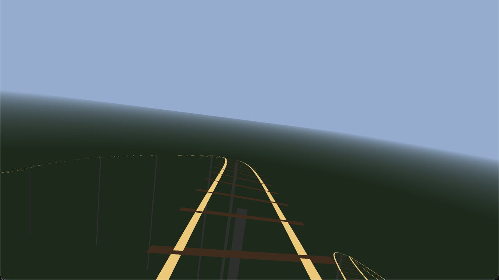

# Roller Coaster

A barebones first-person roller coaster. The point of the example is the path:
how a handful of control points become a smooth, banked ride.



```sh
./run.sh
./run.sh --build-only
./run.sh --stats
```

The app bundle is written to
`/tmp/cpp-games-roller-coaster-build/RollerCoaster.app`.

Controls: `P` pause, `R` restart, `F`/`F11` fullscreen, `Esc`/`Q` quit.

## How the path is generated

The path code is split across:

- [`Sources/Core/Track.cpp`](Sources/Core/Track.cpp) — route generation and arc-length lookup.
- [`Sources/Render/TrackMesh.cpp`](Sources/Render/TrackMesh.cpp) — rails, ties, supports.
- [`Sources/App/Main.cpp`](Sources/App/Main.cpp) — motion and camera.

### 1. Control points

The route starts as a closed list of ten points:

```cpp
const std::array<Vec3, 10> controlPoints = {{
    {0, 20, 0},
    {0, 16, 26},
    ...
}};
```

These are the peaks, valleys, and turn locations. They are not the track yet.

### 2. Smooth with a centripetal Catmull-Rom spline

For each segment, the four surrounding points shape a smooth curve:

```cpp
catmullRom(p0, p1, p2, p3, t)
```

The centripetal version is important. Uniform Catmull-Rom can overshoot and
create small loops or kinks around sharp turns, which the camera feels as a
jolt.

### 3. Resample by arc length

The smooth curve is first sampled densely, then resampled into 700 points at
equal distances around the loop.

This makes speed honest: moving one metre means moving one metre, regardless of
how the spline was sampled.

### 4. Build a frame at every sample

Each sample stores:

- `position` — where the track is.
- `tangent` — forward direction.
- `right` — sideways direction.
- `up` — local up.

The frame is banked into turns. The raw turn signal is smoothed before applying
it, so the horizon does not twitch from one sample to the next.

The camera also looks ahead by several metres. That makes the view follow the
next bend smoothly instead of pivoting abruptly at a sample boundary.

### 5. Drive the camera

`distance` is a scalar around the loop:

```cpp
distance = fmod(distance + speed * delta, track.length);
```

Speed comes from a simple energy model: faster low down, slower over crests.
Motion is integrated at a fixed 120 Hz step, so a slow frame does not teleport
the camera.

## Try it

- Move a control point and watch the entire route change.
- Add another control point.
- Change the bank multiplier.
- Replace the energy-based speed with a constant.
- Raise or lower the camera offset above the rails.
